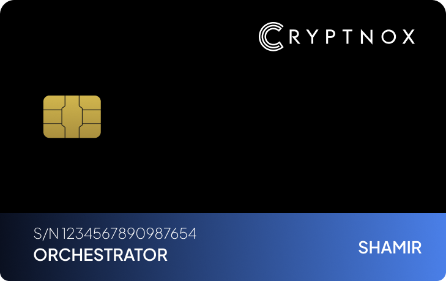
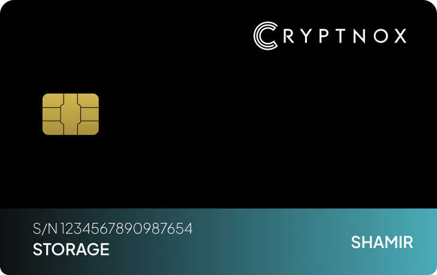
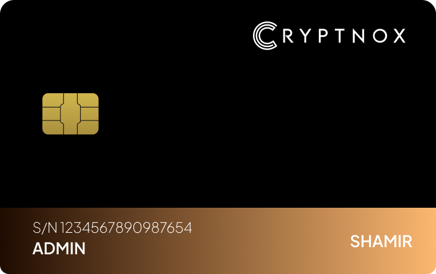

Cards
=====

The system uses three types of Cryptnox smart card, distinguished by a
colour-coded band and a printed role. All are standard **ID-1** cards
(85.6 × 54 mm) with a **gold contact chip**, a unique **serial number (S/N)**
printed on the front, and the **CRYPTNOX** / **SHAMIR** branding.

.. note::

   **Contact only.** The Shamir applets reject contactless/NFC — always use a
   contact reader and insert the card.

The three card types
--------------------

Orchestrator (blue)
~~~~~~~~~~~~~~~~~~~~~

   Orchestrator card — performs all cryptography.

Generates the seed, splits it via Shamir, exports the encrypted shares, and
reconstructs the seed during recovery. Holds **no** share at rest; it is reset
and reused between operations. One per set. See :doc:`concepts`.

**On the card:** only the **S/N** and branding are factory-set. The back is a
printed form — at the ceremony, write the **Bundle** name and an
**administrator code** + date in the **Notes** area.

Storage (teal)
~~~~~~~~~~~~~~

   Storage card — holds one encrypted share.

Securely stores exactly **one** encrypted Shamir share, protected by a
4-character PIN. Two to twelve per set. These are the cards you distribute to
custodians and store in safes.

**On the card:** only the **S/N** and branding are factory-set. The back is a
printed form you fill in at the ceremony: the **Bundle** name, this card's
**share number** (e.g. *#3*), and a **custodian code** + **Ceremony date** in
the *Notes* area. **Do not write the total or the threshold on the card** —
record the full ``k``-of-``n`` in your custody log only, so a single lost card
does not reveal the scheme.

Admin (gold)
~~~~~~~~~~~~

   Admin card — resets the PIN of a storage card.

Administrative recovery card: it **resets the PIN** of a storage card — for
example when a custodian forgets their PIN or leaves the organisation. Keep it
under strict control (it governs access recovery to the storage cards).

.. important::

   **The Admin card is itself PIN-protected** (its own PIN, separate from the
   storage PINs; default ``0000``, change it at provisioning). It will not sign a
   reset until that PIN is verified, so the card **alone is useless** — an attacker
   needs both the card **and** its PIN (two-factor). The PIN allows **10** attempts;
   after that the card **locks permanently** (nothing can reset the Admin card — the
   fallback is the k-of-n recovery quorum). Store the Admin card and its PIN
   separately, and never together with the storage cards.

**On the card:** only the **S/N** and branding are factory-set; write the
**Bundle** name in the *Notes* area and keep the card with the administrator.

.. _hardware:card-backs:

Card markings
-------------

From the factory each card carries only a fixed **S/N** and the branding. At the
ceremony you write, in the printed fields on the back, the **Bundle** name and —
on storage cards — this card's **share number** (e.g. *#3*), plus a short,
**non-identifying** custody code and the ceremony date in the **Notes** area.

**Keep the total and threshold off the cards.** Record the full ``k``-of-``n``
**only in your custody log**: a single lost or stolen card should not reveal how
many cards exist or how many are needed. The card cannot report its share number
electronically, so recovery relies on the number you write — write it carefully.
See :ref:`ceremony:labelling` and :doc:`parameters`.

.. warning::

   Write **codes only** in the *Notes* area — **never a full name or a
   handwritten signature**. Both identify a person tied to the secret and
   invite **coercion**. The code → name mapping and the holder's signed
   acknowledgement of receipt live **only** in the secured custody log (see
   :ref:`ceremony:labelling`).

.. _hardware:pin-levels:

Storage card PIN — security levels
----------------------------------

When provisioning storage cards, the administrator chooses a PIN policy. Pick
the level that matches your custody and recovery requirements.

.. list-table::
   :header-rows: 1
   :widths: 8 30 62

   * - Level
     - Policy
     - Implication
   * - **A**
     - Default PIN ``0000``
     - Simplest, **lowest security** — anyone holding the card can read its
       share. Use only for testing or very low-risk setups.
   * - **B**
     - PIN changed (per card)
     - The share is protected by a secret PIN. **If the PIN is lost, the card
       (and its share) is unrecoverable** — you must rely on the *k*-of-*n*
       quorum from the other cards.
   * - **C**
     - PIN changed **+ Admin card**
     - The share is PIN-protected **and** a forgotten/locked PIN can be
       **reset with the Admin card** — recommended for organisations
       (resilient to personnel changes and forgotten PINs).

.. tip::

   For an institutional deployment, choose **Level C**: per-card PINs for
   security, plus an Admin card so a forgotten PIN never forces you to fall
   back on the quorum. Store the Admin card separately, under its own control.

.. seealso::

   - :doc:`governance` — the operational lifecycle and checklists.
   - :doc:`security_model` — what a stolen card reveals, PINs, audit.
   - :doc:`ceremony` — provisioning the cards into a set.
